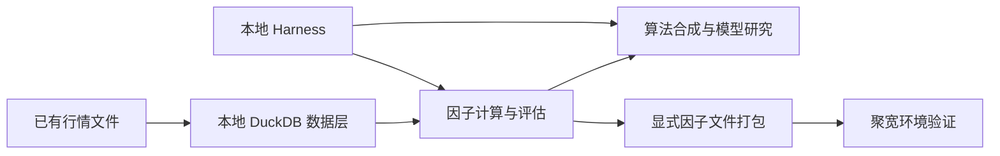

# JQ Factor Lab

**把聚宽研究中的重计算迁到本地，并为本地 Harness 提供可调用的研究接口。**

研究涉及长历史、大股票池、分钟数据或反复训练时，聚宽研究环境的计算资源容易成为瓶颈。JQ Factor Lab 将数据读取、因子计算、单因子评估和算法合成组织为本地 Python 模块，让这些任务使用自己的 CPU、内存和存储资源。

本地 Harness 可以通过 CLI 或 Python 接口调度研究任务、读取结果，再决定下一步实验。需要回到聚宽验证的因子，可以通过共享接口和单文件构建器打包，形成“本地研究 → 聚宽验证”的工作流。

## 解决什么问题

- **让计算跟随本地资源扩展。** 数据保存在本地，因子计算、评估和模型研究在本机执行，减少对聚宽研究 Notebook 计算配额的依赖。
- **让研究任务可以被 Harness 调用。** 提供配置驱动的 CLI、JSON 成功摘要、明确的进程退出状态和落盘结果，便于本地任务调度器、脚本或 agent 串联实验。
- **衔接本地研究与聚宽运行。** 通过因子基类、数据 adapter、PIT 复权和显式构建入口组织同一套因子实现，减少两端各写一套计算逻辑的维护成本。

数据来源、字段、交易日历和时间边界需要显式配置。把计算迁到本地后，仍需分别核验输入数据、因子数值和交易执行的一致性。

## 工作流



数据通过本地文件导入；计算与评估在本地完成。Harness 负责外层任务编排，本项目提供可组合的执行模块。训练模型接入聚宽需要显式集成和验证。

## 快速开始

支持 Python 3.11–3.12、macOS / Linux。部分缓存锁依赖 POSIX `fcntl`，暂不支持原生 Windows。

```bash
git clone https://github.com/GSX-Eis/jq-factor-lab.git
cd jq-factor-lab

python -m venv .venv
source .venv/bin/activate
python -m pip install -e '.[dev,synthesis]'

# 生成教学行情，运行本地单因子评估
python -m examples.generate_data --output data/demo.csv
python -m tools.agent_harness.cli single-factor-analysis \
  --config config/demo.json --output-dir outputs/first-analysis

# 运行固定权重合成示例
python -m tools.agent_harness.cli factor-synthesis-demo \
  --method weighted_sum --output-dir outputs/first-synthesis
```

安装后也可使用 `jq-factor-lab` 命令调用同一 CLI。单因子分析会生成 `summary.json`、`factor_values.csv` 和评估结果 CSV，包含 IC、IR 与分层收益等结果。

示例仅使用合成行情和虚构市场日历。每次运行应指定新的输出目录；已有目录会被拒绝。使用真实数据时，需要提供明确的交易日历来源，见 [配置参考](docs/CONFIG.md) 和 [交易日历](docs/TRADING_CALENDAR.md)。

## 接入本地 Harness

### 通过 CLI 调度单因子评估

Harness 可以启动进程，传入配置和任务独立的输出目录：

```python
import json
import subprocess
import sys

process = subprocess.run(
    [sys.executable, "-m", "tools.agent_harness.cli", "single-factor-analysis",
     "--config", "config/demo.json", "--output-dir", "outputs/harness-job-001"],
    check=True,
    capture_output=True,
    text=True,
)
summary = json.loads(process.stdout)
```

成功时 stdout 为 JSON 摘要，包含因子名、输入行数、股票数、IC 均值和日历身份；过程日志写到 stderr。失败时进程非零退出，Harness 应检查 stderr 并停止消费该任务的结果。输出目录应由调用方按任务分配。

### 通过 Python 模块扩展研究流程

| 接入层 | 提供的能力 |
| --- | --- |
| 因子计算 | `FactorBase`、显式因子文件加载、日频与五分钟数据读取接口 |
| 数据与结果 | 本地 CSV → DuckDB 导入、缓存、因子读写与结果持久化 |
| 单因子评价 | PIT 价格调整、前瞻收益、Alphalens 评价与股票池过滤 |
| 合成研究 | 固定权重、PCA、线性模型、LightGBM，以及预筛选、预处理、交叉验证和诊断模块 |
| 聚宽衔接 | `JQFactorAdapter` 与明确输入的单文件构建器 |

公开 CLI 当前提供单因子评估和合成教学示例。自有 Harness 可调用底层模块扩展调度；训练与选模需要生产方提供真实标签退出上下文，具体合同见 [算法合成](docs/SYNTHESIS.md)。

给 agent 接入时，从 [AGENTS.md](AGENTS.md) 开始；[CLAUDE.md](CLAUDE.md) 引用同一份文档索引。

## 换成自己的数据与因子

1. 按 [数据导入](docs/DATA_IMPORT.md) 准备本地行情、辅助数据和已验证日历，导入 DuckDB。
2. 继承 `utils.factor_base.FactorBase`，实现取数和计算方法。因子接口见 [FACTOR_INTERFACE](docs/FACTOR_INTERFACE.md)，最小骨架见 [FACTOR_TEMPLATE](docs/FACTOR_TEMPLATE.md)。
3. 在自己的 Harness 中配置日期、股票池、数据源和输出位置，调用计算、评估或合成模块。
4. 对需要带回聚宽的因子，声明字段与历史窗口，再构建并验证运行文件。

日频单因子 CLI 接受含 `date, stock_code, close` 的 CSV，可选正数复权字段 `factor`，缺省为 1。它将输入放入内存 DuckDB 后调用共享因子与评价模块；自有 Harness 可以另行使用持久化 DuckDB 和版本化存储接口。

完整的“CSV → DuckDB → 自定义因子 → 固定权重合成 → 价格收益标签 → 聚宽文件”教学流程：

```bash
python -m examples.local_factor_workflow --output-dir outputs/local-workflow
```

每一步的接口、产物和替换方法见 [LOCAL_WORKFLOW](docs/LOCAL_WORKFLOW.md)。

## 带回聚宽验证

```bash
python -m scripts.build_jq_strategy \
  --factor-files examples/momentum.py \
  --requirements config/factor_requirements.json \
  --cloud-api-mapping config/cloud_api_mapping.json \
  --single-file --out outputs/demo_jq_strategy.py
```

构建在本地完成，无需聚宽账号，也不会请求行情或上传文件。生成文件需在聚宽环境另行运行；教学入口计算因子并记录日志。字段映射、依赖和构建合同见 [聚宽运行工具链](docs/JOINQUANT.md)。

## 能力范围

本仓库提供通用研究模块、公开 CLI、教学示例和测试，不包含真实行情、已有研究因子、个人实验配置、预训练模型或生产策略。行情下载、平台登录和自动上传需另行安排。

固定权重合成示例可以直接运行；其余六种教学方法的人工目标没有经核验的标签退出上下文，会在训练前拒绝执行。底层算法需要由调用方接入正确的标签与时间隔离合同。详见 [合成示例边界](docs/SYNTHESIS.md)。

聚宽 adapter 和构建器已接入。公开版的真实聚宽云端运行与完整交易回测尚未验收；单因子评价和本地示例的通过不代表策略表现或两端交易结果已验证。

## 文档与贡献

| 内容 | 文档 |
| --- | --- |
| 配置、默认值与输出 | [CONFIG](docs/CONFIG.md) |
| 因子接口与最小模板 | [FACTOR_INTERFACE](docs/FACTOR_INTERFACE.md) · [FACTOR_TEMPLATE](docs/FACTOR_TEMPLATE.md) |
| 复权、缺失值与时间边界 | [SEMANTICS](docs/SEMANTICS.md) |
| 本地数据与日历 | [DATA_IMPORT](docs/DATA_IMPORT.md) · [TRADING_CALENDAR](docs/TRADING_CALENDAR.md) |
| 合成算法与标签合同 | [SYNTHESIS](docs/SYNTHESIS.md) |
| 本地到聚宽的完整示例 | [LOCAL_WORKFLOW](docs/LOCAL_WORKFLOW.md) · [JOINQUANT](docs/JOINQUANT.md) |
| 公开范围 | [PUBLIC_SCOPE](docs/PUBLIC_SCOPE.md) |

开发环境安装后可运行 `python -m pytest -q`。贡献要求见 [CONTRIBUTING](CONTRIBUTING.md)，漏洞报告见 [SECURITY](SECURITY.md)，版本记录见 [CHANGELOG](CHANGELOG.md)。

本项目采用 [Apache License 2.0](LICENSE)，版权声明见 [NOTICE](NOTICE)。第三方依赖保留各自的许可证。
