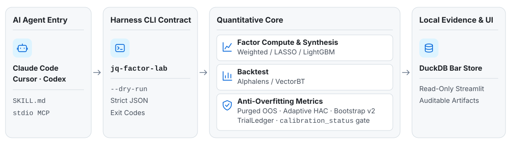

<div align="center">

# JQ Factor Lab

**An AI-native quantitative research harness for multi-factor computation and synthesis, backtesting, and anti-overfitting statistical evaluation through CLI and MCP.**

English · [简体中文](README.zh-CN.md)

[](https://github.com/GSX-Eis/jq-factor-lab/actions/workflows/ci.yml?query=branch%3Amain)
[](CHANGELOG.md)

[](LICENSE)

</div>

<div align="center">
  <picture>
    <source media="(prefers-color-scheme: dark)" srcset="docs/assets/architecture-dark.svg">
    
  </picture>
</div>

## Why this exists

JQ Factor Lab runs a local, inspectable research loop with DuckDB on one machine. The same evaluation engine covers daily cross-sections and minute-Bar time series. Agents can preflight a command, parse one strict JSON response, and trace the result to the artifacts and their statistical gates.

| Project | Primary workflow | Where JQ Factor Lab fits |
| --- | --- | --- |
| [Qlib](https://github.com/microsoft/qlib) | ML-based quantitative research and investment workflows | A local DuckDB workflow for evaluating daily cross-sections and minute Bars under one contract |
| [RD-Agent](https://github.com/microsoft/RD-Agent) | Agent-driven research and development | An execution surface with deterministic inputs and output contracts, JSON, dry-run plans and exit codes |
| [VectorBT](https://github.com/polakowo/vectorbt) | Vectorized portfolio backtesting | Factor evaluation with Adaptive HAC, Bootstrap v2, TrialLedger and a `calibration_status` gate, with VectorBT available for strategy backtests |
| [TradingAgents](https://github.com/TauricResearch/TradingAgents) | Multi-agent trading analysis and decisions | Reproducible quantitative factor experiments with point-in-time timing, purged splits and auditable evidence |

### Built-in anti-leakage & execution guards

- **Automatic causal gate**: `single-factor-analysis`, `time-series-analysis`, and standalone `verify-factor-causality` run truncation and point-in-time checks to reject lookahead bias on fast-path factors.
- **Unified execution clock (`ExecutionScheduler`)**: Single-factor evaluation, synthesis, and portfolio backtesting share one signal-availability-to-execution bar contract.
- **Anti-overfitting inference gates**: Adaptive HAC, paired Moving-Block Bootstrap v2, `calibration_status` applicability checks, and `TrialLedger` (Holm / BH) multiple-testing control ([evaluation engine](docs/EVALUATION_ENGINE.md), [evaluation policy](docs/EVAL_POLICY.md)).
- **Contract-level portfolio execution**: The VectorBT adapter supports equity cross-sections as well as single-account futures contract execution with session-boundary rolls, margin-rate caps, and lot rounding.

## 60-second quickstart

Use Python 3.11–3.12 on macOS or Linux. First-time dependency installation can take longer. Clone the repository, then choose pip or uv.

```bash
git clone https://github.com/GSX-Eis/jq-factor-lab.git
cd jq-factor-lab
```

**pip**

```bash
python3 -m venv .venv
source .venv/bin/activate
python3 -m pip install '.[synthesis,viz]'
```

**uv**

```bash
uv venv --python 3.12
source .venv/bin/activate
uv pip install '.[synthesis,viz]'
```

When the distribution is available on PyPI, use `python3 -m pip install 'jq-factor-lab[synthesis,viz]'` or `uv pip install 'jq-factor-lab[synthesis,viz]'`. Core includes daily and Bar evaluation. Add `[synthesis]` for synthesis methods, `[viz]` for the dashboard, `[mcp]` for the stdio server, or install additional research extras listed in [End-to-end capabilities & optional extras](#end-to-end-capabilities--optional-extras). `[all]` installs every extra including Qlib and Torch, subject to platform wheel availability.

Run these commands from a writable directory. All demos use synthetic data and allocate fresh run directories.

```bash
jq-factor-lab daily-demo > daily.json
jq-factor-lab bar-demo > bar.json
jq-factor-lab factor-synthesis-demo --method weighted_sum > synthesis.json
db="$(python3 -c 'import json; print(json.load(open("bar.json"))["metrics"]["results_db"]["path"])')"
jq-factor-lab read-bar-evaluations --results-db "$db" > bar-read.json
jq-factor-lab dashboard --results-db "$db" --dry-run
# Drop --dry-run to open the read-only dashboard at http://127.0.0.1:8501.
```

The Bar response includes this diagnostic for the 1-Bar horizon, excerpted from a synthetic run. Its constant returns leave Spearman IC undefined.

```json
{
  "ok": true,
  "exit_code": 0,
  "metrics": {
    "diagnostics_report": {
      "schema": "time_series_diagnostics.v1",
      "horizons": [
        {"horizon_bars": 1, "ic": {"sample_count": 39, "spearman_ic": null, "reason": "constant_return"}}
      ]
    }
  },
  "next_actions": ["Pass metrics.results_db.path to read-bar-evaluations --results-db."]
}
```

The [AI workflow showcase](docs/AI_WORKFLOW_SHOWCASE.md) follows several candidates through preflight, calibration and trial gates, synthesis, a toy backtest and DuckDB read-back.

## Plug into your AI agent

### Agent Skill or Claude Code plugin

Copy the entire [Factor Research Skill](skills/factor-research/SKILL.md) directory, including its references, into your client's skills directory. With Claude Code, run `claude --plugin-dir .` from the checkout to load the [plugin manifest](.claude-plugin/plugin.json) and invoke `/jq-factor-lab:factor-research`. See [AGENTS.md](AGENTS.md) or [CLAUDE.md](CLAUDE.md) for project instructions.

### Stdio MCP server

With `uvx` on the MCP client's PATH, add this entry to `mcpServers` in Claude Desktop, Cursor, Claude Code or Windsurf. Use this package-based config once the distribution is on PyPI. For a local checkout, change the `--from` value to the absolute checkout path with `[mcp,synthesis]` appended. The synthesis extra lets the server run `run_factor_synthesis_demo`.

```json
{
  "mcpServers": {
    "jq-factor-lab": {
      "command": "uvx",
      "args": ["--python", "3.12", "--from", "jq-factor-lab[mcp,synthesis]", "jq-factor-lab-mcp"]
    }
  }
}
```

The server runs locally. Use absolute paths for tool inputs. See the [CLI and MCP mapping](skills/factor-research/references/cli_contract.md).

### Copy a research prompt

```text
Use the Factor Research Skill and run the AI workflow showcase in a fresh
writable directory. Freeze the hypothesis, candidates, split and screening
rule. Use only synthetic data. Preflight each evaluation, capture stdout and
stderr, and report the IC and sample count, null reasons, calibration status
and complete trial family. Combine only the candidates eligible for the
synthetic backtest. Verify the DuckDB and dashboard plan. Report rejected
candidates, artifact paths, and whether the evidence permits a significance claim.
```

## Multi-market data & public benchmarks

### Declarative multi-market adapters (`slot.yaml`)

Connect local [CSV, Parquet or DuckDB](docs/DATA_IMPORT.md) feeds without writing a custom Python adapter by declaring a versioned `slot.yaml`, or use built-in native market slots:

| Market | Coverage | Adapter | Guide |
| --- | --- | --- | --- |
| **China A-shares (daily / minute)** | XSHG / XSHE with point-in-time adjustment and microstructure rules | Native `jq_ashare_local` or CSV / DuckDB | [Local workflow](docs/LOCAL_WORKFLOW.md) |
| **US equities & global indices** | XNYS / XNAS with verified PMC calendars and DST handling | Declarative `slot.yaml` + MarketDB profile | [Market database guide](docs/MARKET_DATABASE_GUIDE.md) |
| **Domestic & global futures** | CME / SHFE / INE / DCE / CZCE / CFFEX / GFEX (ETH/RTH & session rolls) | Native `cn_futures` / `global_futures` | [Trading calendar](docs/TRADING_CALENDAR.md) |
| **24/7 crypto & custom markets** | Arbitrary timezones, 24/7 sessions, and auxiliary series such as funding rates | Zero-code declarative `slot.yaml` | [Crypto example](examples/declarative_crypto/README.md) · [Custom market & deploy guide](docs/CUSTOM_MARKET_AND_DEPLOY_GUIDE.md) |

### One-command public benchmark databases (`[markets]`)

Install `.[markets]` to download, SHA-256 freeze, and build three reproducible public market DuckDBs with versioned `MarketDB` profiles (enforcing single-market isolation against accidental cross-database mixing):

- **Kenneth R. French**: 49 industry portfolios + FF3 daily series (since 1963)
- **Binance Vision**: 10 USDT spot pairs at `1min` and derived `1d` bars
- **AKShare**: China broad-based indices and Shenwan Level-1 industry daily indices

```bash
# Example: fetch and build the Binance spot benchmark database (see docs for French & AKShare)
python3 -m data_pipeline.extractors.public_markets.binance \
  --work-dir work/binance --db work/binance/market.duckdb
python3 -m tools.agent_harness.cli market-db show --db work/binance/market.duckdb
```

See [public market databases](docs/PUBLIC_MARKET_DATABASES.md) for rebuild commands, snapshot verification, and upstream data terms.

### Persistent bar & factor storage

When scaling beyond single CSV runs, store validated bars and futures roll schedules in profile-checked DuckDB (`import-bars`, `build-bars`, `audit-bars`, `build-roll-schedule`), and persist cross-frequency factor values in `MarketFactorValueStore` (Hive-partitioned Parquet + append-only JSONL ledgers + read-only DuckDB views via `write-factor-values` / `read-factor-values` / `verify-factor-values`). See the [Bar and storage contract](docs/TIME_SERIES_CONTRACT.md) and [factor interface](docs/FACTOR_INTERFACE.md).

## End-to-end capabilities & optional extras

Keep the core install lean and add only the extras your workflow needs (`python3 -m pip install 'jq-factor-lab[<extra>]'`):

| Stage | Capabilities | Extra | Guide / entry |
| --- | --- | --- | --- |
| **Single-factor evaluation** | Daily cross-sections and minute Bars, causal gate, DuckDB persistence | Core | [Evaluation engine](docs/EVALUATION_ENGINE.md) · [Evaluation policy](docs/EVAL_POLICY.md) |
| **Symbolic factor mining** | PyTorch DSO policy search with structural priors, DEAP GP meld, and QuantaAlpha proposal gates compiled into standalone `FactorBase` modules | `[mining]` | [run_symbolic_factor_mining.py](run_symbolic_factor_mining.py) |
| **Multi-factor synthesis & backtesting** | LASSO, ElasticNet, PCA, LightGBM, dynamic blend, and size-conditional synthesis paired with VectorBT (equity and single-account futures contracts) | `[synthesis,backtest]` | [Synthesis guide](docs/SYNTHESIS.md) |
| **Strategy bundles & cross-market export** | Immutable SHA-256 `StrategyBundle` contracts exported as cross-market positions and `trade_orders.jsonl` (`signal_export`) or offline JoinQuant single-file strategies (`jq_cloud`) with offline alignment verification | Core / `[synthesis]` | [Custom market & deploy guide](docs/CUSTOM_MARKET_AND_DEPLOY_GUIDE.md) · [JoinQuant adapter](docs/JOINQUANT.md) |
| **Public benchmark datasets** | Reproducible French, Binance Vision, and AKShare extractors | `[markets]` | [Public market databases](docs/PUBLIC_MARKET_DATABASES.md) |
| **Dashboard & agent integration** | Read-only local Streamlit dashboard and stdio MCP server | `[viz,mcp]` | [CLI and MCP mapping](skills/factor-research/references/cli_contract.md) |

> Additional extras: `[qlib]` (Qlib adapter), `[acceleration]` (Numba), `[dev]` (test suite), and `[all]` (every extra).

```bash
# Export and verify portable cross-market target positions and orders from a StrategyBundle
python3 -m tools.agent_harness.cli export-strategy --target signal_export \
  --bundle-dir "$BUNDLE_DIR" --output-dir work/signal-candidate
python3 -m tools.agent_harness.cli verify-target-alignment --target signal_export \
  --bundle-dir "$BUNDLE_DIR" --artifact-dir work/signal-candidate
```

## CLI surface

JQ Factor Lab exposes a **two-tier CLI**, with strict JSON output and `--dry-run` preflight across commands:

- **Public agent CLI (`jq-factor-lab`)**: 7 focused commands for demos (`daily-demo`, `bar-demo`, `factor-synthesis-demo`), local evaluation (`single-factor-analysis`, `time-series-analysis`), DuckDB read-back (`read-bar-evaluations`), and the local viewer (`dashboard`), with `--compact` single-line JSON output.
- **Full research harness (`python3 -m tools.agent_harness.cli`)**: 20 subcommands for external orchestrators and multi-market pipelines, alongside standalone research entry points ([run_analysis_main.py](run_analysis_main.py), [run_factor_synthesis.py](run_factor_synthesis.py), [run_symbolic_factor_mining.py](run_symbolic_factor_mining.py)). See [public scope](docs/PUBLIC_SCOPE.md).

<details>
<summary>Full Harness CLI command reference (20 commands)</summary>

| Group | Commands |
| --- | --- |
| **Market DB & bar governance** | `market-db` (`init` / `adopt` / `show` / `migrate-profile`), `import-bars`, `build-bars`, `audit-bars`, `build-roll-schedule` |
| **Factor value store** | `write-factor-values`, `read-factor-values`, `verify-factor-values` |
| **Evaluation, causal gate & queries** | `single-factor-analysis`, `time-series-analysis`, `verify-factor-causality`, `read-bar-evaluations` |
| **Symbolic mining & screening** | `symbolic-factor-mining`, `quanta-alpha-realize`, `parent-factor-screen` |
| **Synthesis & deployment alignment** | `factor-synthesis`, `export-strategy`, `verify-target-alignment`, `alignment-run` |
| **Monitoring & cleanup** | `monitor-refresh`, `outputs-gc` |

</details>

## Feedback & Community

[Open an issue](https://github.com/GSX-Eis/jq-factor-lab/issues/new/choose) to report a bug, request a market calendar or data contract, or share an AI workflow. Share synthetic or sanitized examples. See [contributing](CONTRIBUTING.md), [security](SECURITY.md), and the [changelog](CHANGELOG.md).

Licensed under the [Apache License 2.0](LICENSE). See [NOTICE](NOTICE) for attribution.
