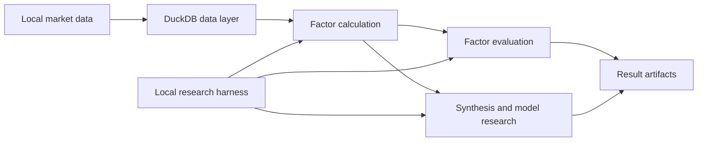

# JQ Factor Lab

English | [简体中文](README.zh-CN.md)

**Local factor research with Python modules and a CLI for your research harness.**

Run factor calculations and evaluations on your own compute, keep datasets and outputs local, and connect research steps to your existing scheduler, experiment runner, or agent. JQ Factor Lab provides a shared factor interface, DuckDB data access, point-in-time price adjustment, forward returns, Alphalens evaluation, and factor synthesis modules.

## What you can do

- **Use your own compute.** Work with local data and use your machine's CPU, memory, and storage for longer histories, larger universes, and repeated experiments.
- **Connect a research harness.** Launch configuration-driven CLI jobs, parse JSON success summaries, check process exit codes, and collect results from a job-specific directory.
- **Compose research workflows.** Combine factor calculation, evaluation, preprocessing, selection, and model modules through Python interfaces.
- **Make data assumptions explicit.** Configure data sources, trading calendars, adjustment rules, and label timing so experiments can be inspected and reproduced against the same inputs.

## Research workflow



The harness handles task scheduling and experiment decisions. This project supplies the execution modules, data interfaces, and outputs that it can build on.

## Quick start

Supported environments: Python 3.11–3.12 on macOS or Linux. Some cache locks use POSIX `fcntl`; native Windows is currently unsupported.

```bash
git clone https://github.com/GSX-Eis/jq-factor-lab.git
cd jq-factor-lab

python -m venv .venv
source .venv/bin/activate
python -m pip install -e '.[dev,synthesis]'

# Generate synthetic prices and evaluate a sample factor
python -m examples.generate_data --output data/demo.csv
python -m tools.demo_cli single-factor-analysis \
  --config config/demo.json --output-dir outputs/first-analysis

# Run the fixed-weight synthesis example
python -m tools.demo_cli factor-synthesis-demo \
  --method weighted_sum --output-dir outputs/first-synthesis
```

After installation, `jq-factor-lab` invokes the same CLI. Single-factor analysis writes `summary.json`, `factor_values.csv`, and evaluation CSV files, including IC, IR, and quantile-return results.

The examples use synthetic prices and a fictional market calendar. Choose a new output directory for each run: existing directories are rejected. For real research, supply an explicit trading-calendar source; see [configuration](docs/CONFIG.md) and [trading calendars](docs/TRADING_CALENDAR.md).

## Integrate with a local harness

### Call the CLI

A harness can start an evaluation job and read its summary:

```python
import json
import subprocess
import sys

process = subprocess.run(
    [sys.executable, "-m", "tools.demo_cli", "single-factor-analysis",
     "--config", "config/demo.json", "--output-dir", "outputs/harness-job-001"],
    check=True,
    capture_output=True,
    text=True,
)
summary = json.loads(process.stdout)
```

On success, stdout contains JSON with the factor name, input row count, asset count, mean IC, and calendar identity. Progress logs go to stderr. A failed job exits with a nonzero status; inspect stderr before consuming its outputs. Allocate output directories per job.

The CLI currently exposes single-factor evaluation and a synthesis tutorial. Use the Python modules to integrate additional training and research workflows.

### Compose Python modules

| Area | Available interfaces and capabilities |
| --- | --- |
| Factor calculation | `FactorBase`, explicit factor-file loading, daily and five-minute data readers |
| Data and artifacts | CSV-to-DuckDB import, caching, factor readers and writers, result persistence |
| Evaluation | PIT price adjustment, forward returns, Alphalens metrics, stock-universe filtering |
| Synthesis | Fixed weights, PCA, linear models, LightGBM, preprocessing, selection, cross-validation, and diagnostics |

Training and model selection require verified label exit dates and valid time-isolation context from the caller. Interface details are documented in [synthesis](docs/SYNTHESIS.md).

For agent-assisted work, start with [AGENTS.md](AGENTS.md). [CLAUDE.md](CLAUDE.md) points to the same documentation index.

## Use your own data and factors

1. Prepare market data, auxiliary inputs, and a verified calendar using the [data import guide](docs/DATA_IMPORT.md).
2. Subclass `utils.factor_base.FactorBase` and implement data fetching and calculation. See the [factor interface](docs/FACTOR_INTERFACE.md) and [minimal template](docs/FACTOR_TEMPLATE.md).
3. Configure dates, universe, data sources, and output locations in your harness, then call the calculation, evaluation, or synthesis modules.

The daily evaluation CLI accepts CSV columns `date, stock_code, close` and an optional positive adjustment `factor`, which defaults to 1. It loads the input into an in-memory DuckDB database and calls the shared factor and evaluation modules. Python clients can also use persistent DuckDB stores and versioned storage interfaces.

A complete synthetic example demonstrates data import, custom factors, fixed-weight synthesis, price-derived labels, and generation of a platform integration file:

```bash
python -m examples.local_factor_workflow --output-dir outputs/local-workflow
```

See [the local workflow guide](docs/LOCAL_WORKFLOW.md) for inputs, artifacts, and how to replace the tutorial data.

## Scope and validation

The repository contains reusable research modules, CLI commands, tutorials, and tests. Bring your own market data and research configuration. Existing research factors, trained models, and production strategies are not included.

The fixed-weight synthesis tutorial runs directly. Its six other methods reject the tutorial's artificial targets because they lack verified label exit dates. To train with those modules, provide real labels and the required isolation context; see [synthesis contracts](docs/SYNTHESIS.md).

Factor evaluation and synthetic examples do not establish investment performance or validate a complete trading backtest. Platform execution and trading behavior need separate verification.

## Optional platform integration

A JoinQuant adapter and a local single-file builder are available when your workflow needs them:

```bash
python -m scripts.build_jq_strategy \
  --factor-files examples/momentum.py \
  --requirements config/factor_requirements.json \
  --cloud-api-mapping config/cloud_api_mapping.json \
  --single-file --out outputs/demo_jq_strategy.py
```

Building requires no platform login, requests no market data, and uploads no files. Run and validate the generated file separately in the target environment. Trained models require explicit integration. See [the integration guide](docs/JOINQUANT.md) for field mappings and runtime contracts.

## Documentation and contributing

The detailed reference guides below are currently written in Chinese.

| Topic | Guide |
| --- | --- |
| Configuration and outputs | [CONFIG](docs/CONFIG.md) |
| Factor interface and template | [FACTOR_INTERFACE](docs/FACTOR_INTERFACE.md) · [FACTOR_TEMPLATE](docs/FACTOR_TEMPLATE.md) |
| Adjustment, missing values, and time boundaries | [SEMANTICS](docs/SEMANTICS.md) |
| Local data and calendars | [DATA_IMPORT](docs/DATA_IMPORT.md) · [TRADING_CALENDAR](docs/TRADING_CALENDAR.md) |
| Synthesis and label contracts | [SYNTHESIS](docs/SYNTHESIS.md) |
| End-to-end example | [LOCAL_WORKFLOW](docs/LOCAL_WORKFLOW.md) |
| Distribution scope | [PUBLIC_SCOPE](docs/PUBLIC_SCOPE.md) |

Run `python -m pytest -q` in the development environment. See [CONTRIBUTING](CONTRIBUTING.md), [SECURITY](SECURITY.md), and [CHANGELOG](CHANGELOG.md) for contribution guidelines, vulnerability reporting, and changes.

Licensed under the [Apache License 2.0](LICENSE). See [NOTICE](NOTICE) for attribution. Third-party components retain their own licenses.
