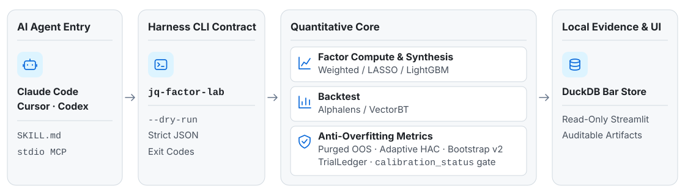

<div align="center">

# JQ Factor Lab

**An AI-native quantitative research harness for multi-factor computation and synthesis, backtesting, and anti-overfitting statistical evaluation through CLI and MCP.**

English · [简体中文](https://github.com/GSX-Eis/jq-factor-lab/blob/v0.2.0/README.zh-CN.md)

[](https://github.com/GSX-Eis/jq-factor-lab/actions/workflows/ci.yml?query=branch%3Amain)
[](https://github.com/GSX-Eis/jq-factor-lab/blob/v0.2.0/CHANGELOG.md)

[](https://github.com/GSX-Eis/jq-factor-lab/blob/v0.2.0/LICENSE)

</div>

<div align="center">
  <picture>
    <source media="(prefers-color-scheme: dark)" srcset="https://github.com/GSX-Eis/jq-factor-lab/raw/v0.2.0/docs/assets/architecture-dark.svg">
    
  </picture>
</div>

## Why this exists

JQ Factor Lab runs a local, inspectable research loop with DuckDB on one machine. The same evaluation engine covers daily cross-sections and minute-Bar time series. Agents can preflight a command, parse one strict JSON response, and trace the result to the artifacts and their statistical gates.

| Project | Primary workflow | Where JQ Factor Lab fits |
| --- | --- | --- |
| [Qlib](https://github.com/microsoft/qlib) | ML-based quantitative research and investment workflows | A local DuckDB workflow for evaluating daily cross-sections and minute Bars under one contract |
| [RD-Agent](https://github.com/microsoft/RD-Agent) | Agent-driven research and development | An execution surface with deterministic inputs and output contracts, JSON, dry-run plans and exit codes |
| [VectorBT](https://github.com/polakowo/vectorbt) | Vectorized portfolio backtesting | Factor evaluation with Adaptive HAC, Bootstrap v2, TrialLedger and a `calibration_status` gate, with VectorBT available for strategy backtests |
| [TradingAgents](https://github.com/TauricResearch/TradingAgents) | Multi-agent trading analysis and decisions | Reproducible quantitative factor experiments with point-in-time timing, purged splits and auditable evidence |

## 60-second quickstart

Use Python 3.11–3.12 on macOS or Linux. First-time dependency installation can take longer. Clone the repository, then choose pip or uv.

```bash
git clone https://github.com/GSX-Eis/jq-factor-lab.git
cd jq-factor-lab
```

**pip**

```bash
python3 -m venv .venv
source .venv/bin/activate
python3 -m pip install '.[synthesis,viz]'
```

**uv**

```bash
uv venv --python 3.12
source .venv/bin/activate
uv pip install '.[synthesis,viz]'
```

When the distribution is available on PyPI, use `python3 -m pip install 'jq-factor-lab[synthesis,viz]'` or `uv pip install 'jq-factor-lab[synthesis,viz]'`. Core includes daily and Bar evaluation. Add `[synthesis]` for the weighted demo and synthesis methods, `[viz]` for the dashboard, or `[mcp]` for the stdio server. `[all]` also installs heavier optional components such as Qlib and Torch, subject to platform wheel availability.

Run these commands from a writable directory. All demos use synthetic data and allocate fresh run directories.

```bash
jq-factor-lab daily-demo > daily.json
jq-factor-lab bar-demo > bar.json
jq-factor-lab factor-synthesis-demo --method weighted_sum > synthesis.json
db="$(python3 -c 'import json; print(json.load(open("bar.json"))["metrics"]["results_db"]["path"])')"
jq-factor-lab read-bar-evaluations --results-db "$db" > bar-read.json
jq-factor-lab dashboard --results-db "$db" --dry-run
# Drop --dry-run to open the read-only dashboard at http://127.0.0.1:8501.
```

The Bar response includes this diagnostic for the 1-Bar horizon, excerpted from a synthetic run. Its constant returns leave Spearman IC undefined.

```json
{
  "ok": true,
  "exit_code": 0,
  "metrics": {
    "diagnostics_report": {
      "schema": "time_series_diagnostics.v1",
      "horizons": [
        {"horizon_bars": 1, "ic": {"sample_count": 39, "spearman_ic": null, "reason": "constant_return"}}
      ]
    }
  },
  "next_actions": ["Pass metrics.results_db.path to read-bar-evaluations --results-db."]
}
```

The [AI workflow showcase](https://github.com/GSX-Eis/jq-factor-lab/blob/v0.2.0/docs/AI_WORKFLOW_SHOWCASE.md) follows several candidates through preflight, calibration and trial gates, synthesis, a toy backtest and DuckDB read-back.

## Plug into your AI agent

### Agent Skill or Claude Code plugin

Copy the entire [Factor Research Skill](https://github.com/GSX-Eis/jq-factor-lab/blob/v0.2.0/skills/factor-research/SKILL.md) directory, including its references, into your client's skills directory. With Claude Code, run `claude --plugin-dir .` from the checkout to load the [plugin manifest](https://github.com/GSX-Eis/jq-factor-lab/blob/v0.2.0/.claude-plugin/plugin.json) and invoke `/jq-factor-lab:factor-research`. See [AGENTS.md](https://github.com/GSX-Eis/jq-factor-lab/blob/v0.2.0/AGENTS.md) or [CLAUDE.md](https://github.com/GSX-Eis/jq-factor-lab/blob/v0.2.0/CLAUDE.md) for project instructions.

### Stdio MCP server

With `uvx` on the MCP client's PATH, add this entry to `mcpServers` in Claude Desktop, Cursor, Claude Code or Windsurf. Use this package-based config once the distribution is on PyPI. For a local checkout, change the `--from` value to the absolute checkout path with `[mcp,synthesis]` appended. The synthesis extra lets the server run `run_factor_synthesis_demo`.

```json
{
  "mcpServers": {
    "jq-factor-lab": {
      "command": "uvx",
      "args": ["--python", "3.12", "--from", "jq-factor-lab[mcp,synthesis]", "jq-factor-lab-mcp"]
    }
  }
}
```

The server runs locally. Use absolute paths for tool inputs. See the [CLI and MCP mapping](https://github.com/GSX-Eis/jq-factor-lab/blob/v0.2.0/skills/factor-research/references/cli_contract.md).

### Copy a research prompt

```text
Use the Factor Research Skill and run the AI workflow showcase in a fresh
writable directory. Freeze the hypothesis, candidates, split and screening
rule. Use only synthetic data. Preflight each evaluation, capture stdout and
stderr, and report the IC and sample count, null reasons, calibration status
and complete trial family. Combine only the candidates eligible for the
synthetic backtest. Verify the DuckDB and dashboard plan. Report rejected
candidates, artifact paths, and whether the evidence permits a significance claim.
```

## Bring your own data

Use local [CSV, Parquet or DuckDB](https://github.com/GSX-Eis/jq-factor-lab/blob/v0.2.0/docs/DATA_IMPORT.md), the [factor interface](https://github.com/GSX-Eis/jq-factor-lab/blob/v0.2.0/docs/FACTOR_INTERFACE.md), the [Bar contract](https://github.com/GSX-Eis/jq-factor-lab/blob/v0.2.0/docs/TIME_SERIES_CONTRACT.md), and a verified [trading calendar](https://github.com/GSX-Eis/jq-factor-lab/blob/v0.2.0/docs/TRADING_CALENDAR.md) such as XSHG, CME or NYSE. See the [local workflow](https://github.com/GSX-Eis/jq-factor-lab/blob/v0.2.0/docs/LOCAL_WORKFLOW.md) and [synthesis guide](https://github.com/GSX-Eis/jq-factor-lab/blob/v0.2.0/docs/SYNTHESIS.md) for configuration and label isolation. [JoinQuant single-file packaging](https://github.com/GSX-Eis/jq-factor-lab/blob/v0.2.0/docs/JOINQUANT.md) is an optional offline deployment adapter.

## Feedback & Community

[Open an issue](https://github.com/GSX-Eis/jq-factor-lab/issues/new/choose) to report a bug, request a market calendar or data contract, or share an AI workflow. Share synthetic or sanitized examples. See [contributing](https://github.com/GSX-Eis/jq-factor-lab/blob/v0.2.0/CONTRIBUTING.md), [security](https://github.com/GSX-Eis/jq-factor-lab/blob/v0.2.0/SECURITY.md), and the [changelog](https://github.com/GSX-Eis/jq-factor-lab/blob/v0.2.0/CHANGELOG.md).

Licensed under the [Apache License 2.0](https://github.com/GSX-Eis/jq-factor-lab/blob/v0.2.0/LICENSE). See [NOTICE](https://github.com/GSX-Eis/jq-factor-lab/blob/v0.2.0/NOTICE) for attribution.
