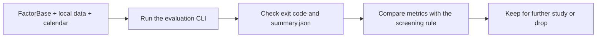

# JQ Factor Lab

English | [简体中文](https://github.com/GSX-Eis/jq-factor-lab/blob/v0.1.0/README.zh-CN.md)

**An agent-ready quantitative factor research harness** with one evaluation engine for multi-asset daily cross-sections and single-instrument minute/Bar time series, multi-market calendars (XSHG, CME, NYSE) via pandas-market-calendars (PMC), and structured Bar diagnostics (`diagnostics_report`).

- **Try it offline** with two built-in synthetic demos, no account required.
- **Bring local data** under explicit [CSV, Parquet and DuckDB contracts](https://github.com/GSX-Eis/jq-factor-lab/blob/v0.1.0/docs/DATA_IMPORT.md), the [Bar schema](https://github.com/GSX-Eis/jq-factor-lab/blob/v0.1.0/docs/TIME_SERIES_CONTRACT.md), and a verified [trading calendar](https://github.com/GSX-Eis/jq-factor-lab/blob/v0.1.0/docs/TRADING_CALENDAR.md). The daily CLI takes a multi-asset CSV. The Bar CLI takes Bar and factor CSVs and can persist evaluations in DuckDB. Python readers also support Parquet.
- **Package for JoinQuant** with the optional [offline single-file builder](https://github.com/GSX-Eis/jq-factor-lab/blob/v0.1.0/docs/JOINQUANT.md). Real market data, trained models, automated login and upload, and cloud or live trading validation are outside the public release.

The built-in demos evaluate 3,600 fictional daily prices and produce minute-Bar diagnostics with sample counts, Spearman IC and explicit reasons for undefined metrics.

## 3-minute quickstart

Use Python 3.11–3.12 on macOS or Linux. Allow extra time for the first dependency download.

```bash
git clone https://github.com/GSX-Eis/jq-factor-lab.git
cd jq-factor-lab
python3 -m venv .venv
source .venv/bin/activate
python3 -m pip install .

jq-factor-lab daily-demo > daily.json
jq-factor-lab bar-demo > bar.json
db="$(python3 -c 'import json; print(json.load(open("bar.json"))["metrics"]["results_db"]["path"])')"
jq-factor-lab read-bar-evaluations --results-db "$db" > bar-read.json
```

Both demos allocate a fresh output directory on each run. The daily JSON gives the `output_dir` containing `summary.json`, factor values and IC, IR and quantile CSVs. The Bar JSON lists artifact paths and hashes and points to the demo DuckDB in `metrics.results_db.path`.

### What the demos return

`daily.json` from `daily-demo`, excerpt from a synthetic run.

```json
{
  "factor": "DemoMomentum",
  "rows": 3600,
  "assets": 20,
  "execution_lag": 1,
  "calendar_id": "DEMO_SYNTHETIC_WEEKDAYS",
  "ic_mean": {"1D": -0.04302664174888087, "5D": -0.05662677403568091, "10D": -0.054942233632862644},
  "ic_observations": {"1D": 173, "5D": 169, "10D": 164}
}
```

`bar.json` from `bar-demo`, showing two of the three diagnostic horizons. The 1-Bar return is constant, so its IC is undefined. The 2-Bar horizon has 38 usable observations. The same run writes `diagnostics_report.csv` and `diagnostics_report.md`.

```json
{
  "ok": true,
  "exit_code": 0,
  "metrics": {
    "analysis_mode": "time_series",
    "diagnostics_report": {
      "schema": "time_series_diagnostics.v1",
      "horizons": [
        {"instrument_id": "DEMO", "frequency": "1min", "horizon_bars": 1,
         "ic": {"sample_count": 39, "spearman_ic": null, "reason": "constant_return"}},
        {"instrument_id": "DEMO", "frequency": "1min", "horizon_bars": 2,
         "ic": {"sample_count": 38, "spearman_ic": 0.8658496553233396, "reason": null}}
      ]
    }
  }
}
```

`bar-read.json` from `read-bar-evaluations`, excerpt. Its `metrics.ic_by_horizon` also contains the persisted 2-Bar Spearman IC shown above.

```json
{
  "ok": true,
  "exit_code": 0,
  "metrics": {"run_count": 1}
}
```

## Give your coding agent one factor to research

Start in [AGENTS.md](https://github.com/GSX-Eis/jq-factor-lab/blob/v0.1.0/AGENTS.md), or use [CLAUDE.md](https://github.com/GSX-Eis/jq-factor-lab/blob/v0.1.0/CLAUDE.md) with Claude Code. Copy this prompt into Claude Code, Codex or Cursor after setup.

```text
In three minutes, screen one synthetic daily factor with JQ Factor Lab. Read
AGENTS.md and run its standalone example in a fresh writable directory. Create
the ThreeSessionReversal FactorBase class, generate the fictional prices and use
the shipped synthetic calendar with execution_lag=1. Run single-factor-analysis
and check the exit code, JSON stdout, stderr log and the run's summary.json.
Set the rule before evaluation. Keep for further study only if 1D mean IC is
at least 0.02 on at least 100 observations. Report keep or drop with the 1D
and 5D ICs, counts and output path. On failure, report the error and defer the
verdict. Run bar-demo and read-bar-evaluations to verify the diagnostics and
persisted run. Keep the experiment offline and use synthetic data only.
```



For a daily CSV provide `date`, `stock_code` and positive `close`. Include the positive PIT adjustment `factor` for real adjusted-price research. The CLI defaults that column to 1 when omitted. For prices and labels, verify calendar coverage through the actual label exits and pick an `execution_lag` that reflects when the signal can be traded. Synthetic and single-factor results support screening only. Strategy backtests and platform execution require separate validation.

## Further workflows

- [Factor interface](https://github.com/GSX-Eis/jq-factor-lab/blob/v0.1.0/docs/FACTOR_INTERFACE.md) and [minimal factor template](https://github.com/GSX-Eis/jq-factor-lab/blob/v0.1.0/docs/FACTOR_TEMPLATE.md)
- [Configuration and outputs](https://github.com/GSX-Eis/jq-factor-lab/blob/v0.1.0/docs/CONFIG.md), [public scope](https://github.com/GSX-Eis/jq-factor-lab/blob/v0.1.0/docs/PUBLIC_SCOPE.md) and [data semantics](https://github.com/GSX-Eis/jq-factor-lab/blob/v0.1.0/docs/SEMANTICS.md)
- [Synthetic factor synthesis and label requirements](https://github.com/GSX-Eis/jq-factor-lab/blob/v0.1.0/docs/SYNTHESIS.md) and the [full local workflow](https://github.com/GSX-Eis/jq-factor-lab/blob/v0.1.0/docs/LOCAL_WORKFLOW.md)
- [Contributing and tests](https://github.com/GSX-Eis/jq-factor-lab/blob/v0.1.0/CONTRIBUTING.md), [security](https://github.com/GSX-Eis/jq-factor-lab/blob/v0.1.0/SECURITY.md), and [changelog](https://github.com/GSX-Eis/jq-factor-lab/blob/v0.1.0/CHANGELOG.md)

## Feedback & Community

After trying the offline demos or your own factor, [open an issue](https://github.com/GSX-Eis/jq-factor-lab/issues/new/choose) to report a bug, request a market calendar or data contract, or share an AI-assisted factor research workflow. Use synthetic or sanitized examples and remove real market data and credentials before posting.

Licensed under the [Apache License 2.0](https://github.com/GSX-Eis/jq-factor-lab/blob/v0.1.0/LICENSE). See [NOTICE](https://github.com/GSX-Eis/jq-factor-lab/blob/v0.1.0/NOTICE) for attribution.
