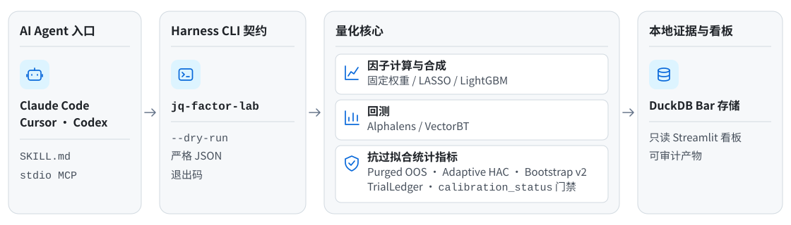

<div align="center">

# JQ Factor Lab

**面向 AI Agent 的量化研究 Harness，通过 CLI 和 MCP 串联多因子计算与合成、回测和抗过拟合统计评测。**

[English](README.md) · 简体中文

[](https://github.com/GSX-Eis/jq-factor-lab/actions/workflows/ci.yml?query=branch%3Amain)
[](CHANGELOG.md)

[](LICENSE)

</div>

<div align="center">
  <picture>
    <source media="(prefers-color-scheme: dark)" srcset="docs/assets/architecture-zh-dark.svg">
    
  </picture>
</div>

## 适用场景

JQ Factor Lab 在单机上使用 DuckDB 完成可追溯的研究流程。日频截面和分钟 Bar 时序共用一套评测引擎。Agent 可以先预检命令，再解析严格 JSON，并将指标追溯到产物和统计门禁。

| 项目 | 主要用途 | JQ Factor Lab 的切入点 |
| --- | --- | --- |
| [Qlib](https://github.com/microsoft/qlib) | 机器学习驱动的量化投研 | 单机 DuckDB 上按统一契约评测日频截面和分钟 Bar |
| [RD-Agent](https://github.com/microsoft/RD-Agent) | Agent 驱动的研发流程 | 输入与输出契约明确的执行入口，提供 JSON、预检计划和退出码 |
| [VectorBT](https://github.com/polakowo/vectorbt) | 向量化组合回测 | 使用 Adaptive HAC、Bootstrap v2、TrialLedger 和 `calibration_status` 门禁评测因子，可接入 VectorBT 做策略回测 |
| [TradingAgents](https://github.com/TauricResearch/TradingAgents) | 多 Agent 交易分析与决策 | 按时点约束、净化切分和可追溯证据复现量化因子实验 |

## 60 秒快速开始

使用 macOS 或 Linux 上的 Python 3.11–3.12。首次下载依赖可能需要更长时间。克隆仓库后，选择 pip 或 uv。

```bash
git clone https://github.com/GSX-Eis/jq-factor-lab.git
cd jq-factor-lab
```

**pip**

```bash
python3 -m venv .venv
source .venv/bin/activate
python3 -m pip install '.[synthesis,viz]'
```

**uv**

```bash
uv venv --python 3.12
source .venv/bin/activate
uv pip install '.[synthesis,viz]'
```

PyPI 上架后，可改用 `python3 -m pip install 'jq-factor-lab[synthesis,viz]'` 或 `uv pip install 'jq-factor-lab[synthesis,viz]'`。基础包提供日频和 Bar 评测，`[synthesis]` 提供固定权重演示和合成依赖，`[viz]` 提供看板，`[mcp]` 提供 stdio 服务。 `[all]` 还会安装 Qlib 和 Torch 等较重依赖，取决于平台 wheel 的可用性。

在可写目录运行以下命令。全部演示均使用合成数据，每次创建独立运行目录。

```bash
jq-factor-lab daily-demo > daily.json
jq-factor-lab bar-demo > bar.json
jq-factor-lab factor-synthesis-demo --method weighted_sum > synthesis.json
db="$(python3 -c 'import json; print(json.load(open("bar.json"))["metrics"]["results_db"]["path"])')"
jq-factor-lab read-bar-evaluations --results-db "$db" > bar-read.json
jq-factor-lab dashboard --results-db "$db" --dry-run
# 去掉 --dry-run 即可在 http://127.0.0.1:8501 打开只读看板。
```

以下是合成 Bar 演示的 1-Bar 周期诊断摘录。常收益使 Spearman IC 无法估计。

```json
{
  "ok": true,
  "exit_code": 0,
  "metrics": {
    "diagnostics_report": {
      "schema": "time_series_diagnostics.v1",
      "horizons": [
        {"horizon_bars": 1, "ic": {"sample_count": 39, "spearman_ic": null, "reason": "constant_return"}}
      ]
    }
  },
  "next_actions": ["Pass metrics.results_db.path to read-bar-evaluations --results-db."]
}
```

[AI 研究战报](docs/AI_WORKFLOW_SHOWCASE.md) 展示多个候选如何经历预检、校准与试验门禁、合成、示例回测及 DuckDB 回查。

## 接入你的 AI Agent

### Agent Skill 或 Claude Code 插件

将完整的 [Factor Research Skill](skills/factor-research/SKILL.md) 目录连同参考文件复制到客户端的 skills 目录。使用 Claude Code 时，可在源码根目录执行 `claude --plugin-dir .` 加载[插件清单](.claude-plugin/plugin.json)，再调用 `/jq-factor-lab:factor-research`。项目约定见 [AGENTS.md](AGENTS.md) 和 [CLAUDE.md](CLAUDE.md)。

### Stdio MCP 服务

确保 MCP 客户端的 PATH 可找到 `uvx`。包上架 PyPI 后，将以下配置加入 Claude Desktop、Cursor、Claude Code 或 Windsurf 的 `mcpServers`。使用本地源码时，把 `--from` 的值改成源码目录的绝对路径并追加 `[mcp,synthesis]`。合成工具 `run_factor_synthesis_demo` 依赖 `[synthesis]`。

```json
{
  "mcpServers": {
    "jq-factor-lab": {
      "command": "uvx",
      "args": ["--python", "3.12", "--from", "jq-factor-lab[mcp,synthesis]", "jq-factor-lab-mcp"]
    }
  }
}
```

服务在本机运行。工具输入使用绝对路径。参见 [CLI 与 MCP 映射](skills/factor-research/references/cli_contract.md)。

### 可直接复制的研究提示词

```text
使用 Factor Research Skill，在新建的可写目录运行 AI 研究战报。
先锁定假设、候选、切分和筛选规则，只使用合成数据。逐项预检，
分开记录 stdout 和 stderr，并报告 IC、样本量、缺失原因、校准状态
和完整试验家族。仅将符合合成回测条件的候选纳入组合。核对 DuckDB
和看板启动计划，列出未通过的候选、产物路径和能否声称统计显著。
```

## 使用本地数据

使用本地 [CSV、Parquet 或 DuckDB](docs/DATA_IMPORT.md)，遵循[因子接口](docs/FACTOR_INTERFACE.md)和 [Bar 契约](docs/TIME_SERIES_CONTRACT.md)，并核验 XSHG、CME、NYSE 等[交易日历](docs/TRADING_CALENDAR.md)。配置和标签隔离见[本地流程](docs/LOCAL_WORKFLOW.md)及[合成指南](docs/SYNTHESIS.md)。[聚宽单文件打包](docs/JOINQUANT.md)是可选的离线部署适配器。

## 试用与反馈

欢迎[提交 Issue](https://github.com/GSX-Eis/jq-factor-lab/issues/new/choose)报告问题、请求市场日历或数据契约，或分享 AI 工作流。请使用合成或脱敏样例。参见[贡献指南](CONTRIBUTING.md)、[安全说明](SECURITY.md)及[变更日志](CHANGELOG.md)。

采用 [Apache License 2.0](LICENSE)。归属信息见 [NOTICE](NOTICE)。
