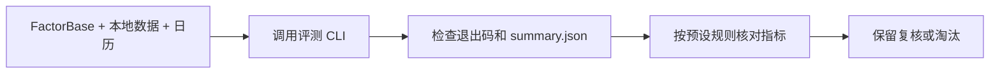

# JQ Factor Lab

[English](README.md) | 简体中文

**Agent-Ready 量化因子研究 Harness**。统一评测引擎支持日频多标的截面与分钟/Bar 单品种时序，使用 pandas-market-calendars（PMC）提供 XSHG、CME、NYSE 多市场交易日历，并输出结构化 Bar 诊断 `diagnostics_report`。

- **离线运行**两套内置合成数据演示，无需账号。
- **按字段契约接入本地数据**，参见 [CSV、Parquet、DuckDB 字段契约](docs/DATA_IMPORT.md)、[Bar 数据规范](docs/TIME_SERIES_CONTRACT.md)和[交易日历核验](docs/TRADING_CALENDAR.md)。日频 CLI 接收多标的 CSV，Bar CLI 接收 Bar 与因子 CSV，也可将评估结果写入 DuckDB。Python 读取接口还支持 Parquet。
- **使用可选的[离线单文件打包器](docs/JOINQUANT.md)** 生成聚宽文件。公开版范围不含真实行情、已训练模型、自动登录上传，以及云端或实盘交易验收。

内置演示评估 3,600 条虚构日频行情，并输出分钟 Bar 诊断，包含样本数、Spearman IC 和指标无法估计的原因。

## 3 分钟快速开始

使用 macOS 或 Linux 上的 Python 3.11–3.12。首次下载依赖的耗时取决于网络。

```bash
git clone https://github.com/GSX-Eis/jq-factor-lab.git
cd jq-factor-lab
python3 -m venv .venv
source .venv/bin/activate
python3 -m pip install .

jq-factor-lab daily-demo > daily.json
jq-factor-lab bar-demo > bar.json
db="$(python3 -c 'import json; print(json.load(open("bar.json"))["metrics"]["results_db"]["path"])')"
jq-factor-lab read-bar-evaluations --results-db "$db" > bar-read.json
```

每次运行演示都会创建独立目录。日频 JSON 的 `output_dir` 下有 `summary.json`、因子值以及 IC、IR 和分位组 CSV。Bar JSON 列出产物路径和哈希，并通过 `metrics.results_db.path` 提供演示 DuckDB 的路径。

### 演示输出

`daily-demo` 生成的 `daily.json`，以下为合成运行节选。

```json
{
  "factor": "DemoMomentum",
  "rows": 3600,
  "assets": 20,
  "execution_lag": 1,
  "calendar_id": "DEMO_SYNTHETIC_WEEKDAYS",
  "ic_mean": {"1D": -0.04302664174888087, "5D": -0.05662677403568091, "10D": -0.054942233632862644},
  "ic_observations": {"1D": 173, "5D": 169, "10D": 164}
}
```

`bar-demo` 生成的 `bar.json`，节选三个诊断窗口中的两个。1 Bar 收益是常数，IC 无法估计。2 Bar 窗口有 38 个可用样本。同次运行还生成 `diagnostics_report.csv` 和 `diagnostics_report.md`。

```json
{
  "ok": true,
  "exit_code": 0,
  "metrics": {
    "analysis_mode": "time_series",
    "diagnostics_report": {
      "schema": "time_series_diagnostics.v1",
      "horizons": [
        {"instrument_id": "DEMO", "frequency": "1min", "horizon_bars": 1,
         "ic": {"sample_count": 39, "spearman_ic": null, "reason": "constant_return"}},
        {"instrument_id": "DEMO", "frequency": "1min", "horizon_bars": 2,
         "ic": {"sample_count": 38, "spearman_ic": 0.8658496553233396, "reason": null}}
      ]
    }
  }
}
```

`read-bar-evaluations` 生成的 `bar-read.json` 节选。`metrics.ic_by_horizon` 也包含上面所示的 2 Bar Spearman IC 落库值。

```json
{
  "ok": true,
  "exit_code": 0,
  "metrics": {"run_count": 1}
}
```

## 让 Coding Agent 自主研究一个因子

从 [AGENTS.md](AGENTS.md) 开始。Claude Code 也可从 [CLAUDE.md](CLAUDE.md) 进入。完成安装后，将下面的 Prompt 复制给 Claude Code、Codex 或 Cursor。

```text
用 JQ Factor Lab 在 3 分钟内初筛一个合成日频因子。阅读 AGENTS.md，在新的可写目录执行
其中的独立示例。创建 ThreeSessionReversal FactorBase 类，生成虚构行情，使用随包提供的
合成日历和 execution_lag=1。运行 single-factor-analysis，检查退出码、JSON stdout、
stderr 日志和本轮 summary.json。评测前先确定规则。仅当 1D 平均 IC 至少为
0.02 且观测数至少为 100 时保留复核。报告保留或淘汰、1D 和 5D 的 IC 与观测数及输出路径。
失败时报告错误，暂缓结论。运行 bar-demo 和 read-bar-evaluations 核对诊断及落库记录。
全程离线，仅用合成数据。
```



日频 CSV 提供 `date`、`stock_code` 和正数 `close`。真实复权研究还应提供正数 PIT 复权列 `factor`，CLI 在省略该列时默认使用 1。核验交易日历覆盖至标签实际退出时点，按信号可交易时间设置 `execution_lag`。合成结果和单因子指标用于初筛，策略回测和平台运行需要单独验证。

## 扩展工作流

- [因子接口](docs/FACTOR_INTERFACE.md)和[最小因子模板](docs/FACTOR_TEMPLATE.md)
- [配置与产物](docs/CONFIG.md)、[公开范围](docs/PUBLIC_SCOPE.md)和[数据语义](docs/SEMANTICS.md)
- [合成示例与标签要求](docs/SYNTHESIS.md)和[完整本地流程](docs/LOCAL_WORKFLOW.md)
- [贡献与测试](CONTRIBUTING.md)、[漏洞报告](SECURITY.md)和[版本记录](CHANGELOG.md)

## 试用与反馈

跑过离线示例或试过自己的因子后，欢迎[选择 Issue 模板](https://github.com/GSX-Eis/jq-factor-lab/issues/new/choose)，反馈 Bug、提出新市场日历或数据契约需求，或分享 AI 辅助因子研究案例。请使用合成或脱敏示例，发帖前移除真实行情数据和凭证。

本项目采用 [Apache License 2.0](LICENSE)。版权声明见 [NOTICE](NOTICE)。
